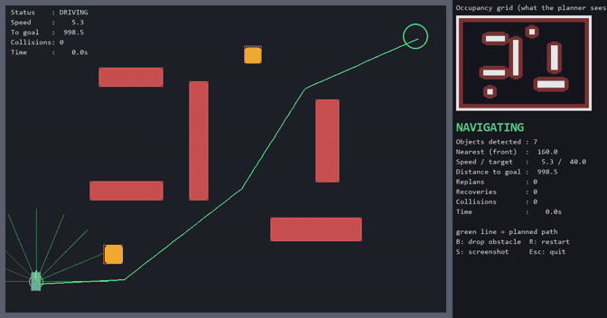
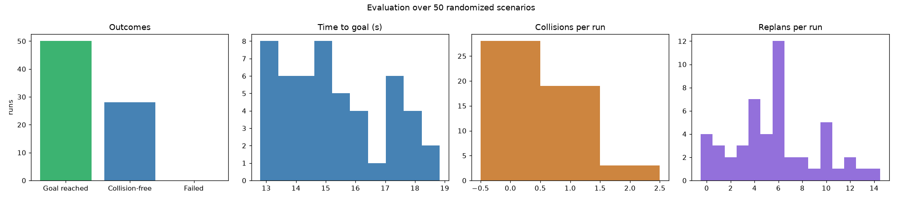
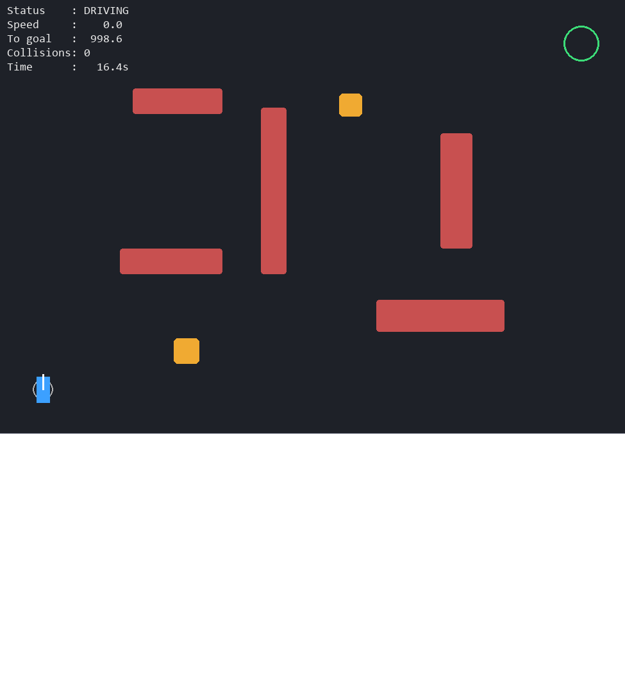
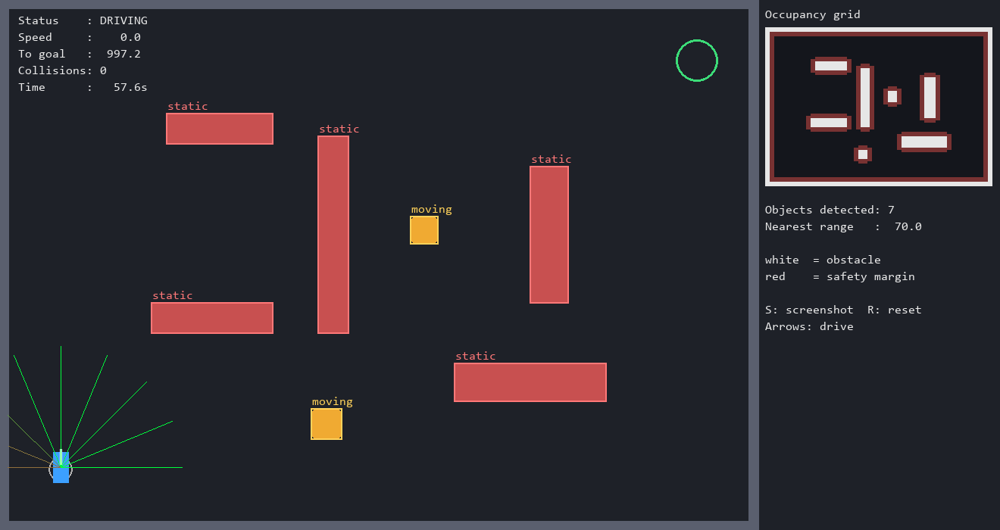
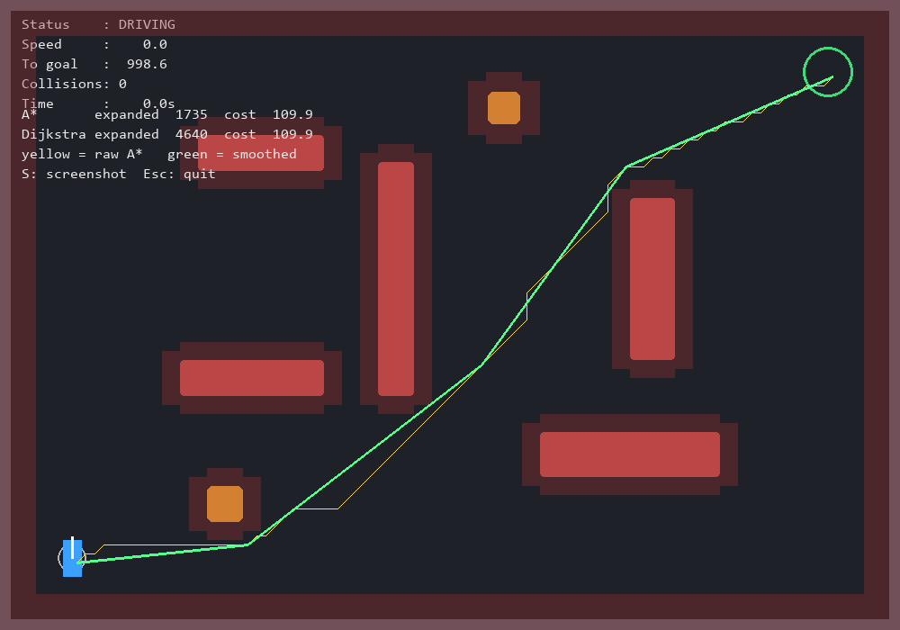
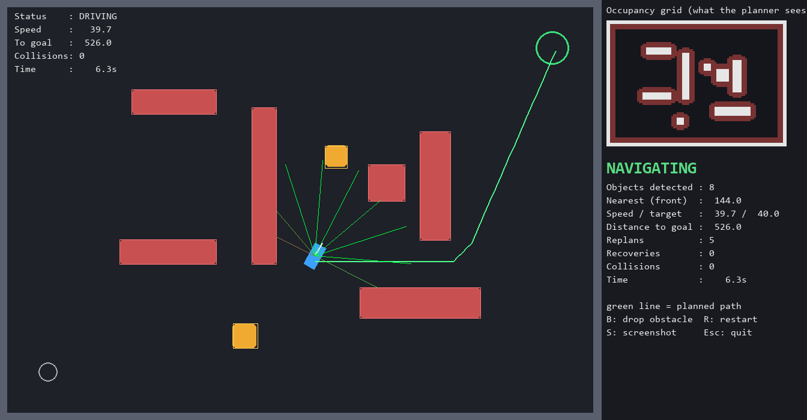

# AI-Based Autonomous Navigation System

A simulation-based autonomous navigation stack in Python: a virtual car perceives its environment with a simulated camera and range sensors, plans a collision-free route with A*, and drives it using pure-pursuit steering and PID speed control, replanning when obstacles block the way.



## Overview

The system covers the full pipeline used in real autonomous robots and vehicles, built entirely in simulation (no hardware or GPU needed):

**Perception → Occupancy grid → Path planning → Control → Safety → Replanning**

The planner never sees the true map. It only uses what the perception module reports.

## Problem statement

Autonomous vehicles, warehouse robots and delivery robots must reach a goal without human control, avoid static and moving obstacles, and adapt when the environment changes. This project builds and evaluates a small version of that pipeline.

## Industry relevance

The same building blocks (perception, occupancy-grid mapping, graph-search planning, tracking control, safety monitors) appear in warehouse AGVs, delivery robots and driver-assistance systems. This project is a learning prototype that demonstrates the concepts, not a production system.

## Features

- Custom 2D simulator (pygame) with static and moving obstacles and a kinematic bicycle-model car
- Simulated top-down camera and OpenCV obstacle detection (blur, color threshold, morphology, contours)
- Occupancy grid with safety-margin inflation
- 9-beam ray-cast range sensor (ultrasonic/LiDAR-like)
- A* planner (8-connected, Euclidean heuristic) with Dijkstra comparison and path smoothing
- Pure-pursuit steering, PID speed control, safety layer, and automatic replanning
- Stuck detection with a back-up recovery behavior
- Live dashboard, video recording, and a 50-scenario randomized evaluation

## Tech stack

Python 3.11, OpenCV, NumPy, pygame, Matplotlib, imageio

## Architecture

```
 Simulated world
      |
      +--> Camera frame --> OpenCV detector --> Occupancy grid (inflated)
      |                                              |
      +--> Range sensor (9 rays) --> Safety layer    v
                                   |          A* planner + smoothing
                                   |                 |
                                   |                 v
                                   +-----------> Pure-pursuit + PID
                                                     |
                                                     v
                                          Throttle / steering --> Car
                                                     ^
                                    Replan when the path ahead is blocked
```

State machine: `IDLE → NAVIGATING ⇄ AVOIDING → RECOVERING → GOAL_REACHED / FAILED`

## Project structure

```
AI-Autonomous-Navigation-System/
├── main.py               # autonomous run with live dashboard (--record for video)
├── evaluate.py           # 50 randomized scenarios -> metrics.csv + charts
├── manual_drive.py       # drive the car yourself (simulator test)
├── perception_demo.py    # visualize camera detections, grid and range rays
├── planning_demo.py      # A* vs Dijkstra on the occupancy grid
├── make_gif.py           # convert the recorded video to a GIF
├── src/
│   ├── navigation.py     # autonomy loop and state machine
│   ├── simulation/       # environment, vehicle, obstacles
│   ├── perception/       # camera, detector, occupancy grid, range sensor
│   ├── planning/         # A*, smoothing, replanner
│   ├── control/          # pure pursuit + PID, safety monitor
│   └── utils/config.py   # all tunable parameters
├── docs/images/          # screenshots, charts, demo GIF
├── outputs/              # logs and generated images
└── requirements.txt
```

## Installation

```bash
git clone https://github.com/TODO-YOUR-USERNAME/AI-Autonomous-Navigation-System.git
cd AI-Autonomous-Navigation-System
python -m venv venv
venv\Scripts\activate        # Windows (macOS/Linux: source venv/bin/activate)
pip install -r requirements.txt
```

Tested with Python 3.11.

## How to run

```bash
python main.py              # autonomous run (B = drop a surprise obstacle, R = restart, S = screenshot)
python main.py --record     # also saves outputs/videos/demo.mp4
python evaluate.py          # 50 randomized scenarios, saves outputs/logs/metrics.csv
python perception_demo.py   # perception view (arrow keys to drive)
python planning_demo.py     # A* vs Dijkstra
python manual_drive.py      # manual driving test
```

## Simulation workflow

1. The camera renders the world and OpenCV detects obstacles.
2. Detections become an occupancy grid, inflated by a safety margin.
3. A* plans a route from the car's position to the goal and the path is smoothed.
4. Pure pursuit steers along the path while a PID controller sets the speed.
5. The safety layer limits speed from the front range-sensor beams.
6. Every few frames the path ahead is re-checked, and the planner replans if it is blocked.

## Results

### Path planning (A* vs Dijkstra)

| Algorithm | Path cost (cells) | Nodes expanded |
|---|---|---|
| A* | TODO | TODO |
| Dijkstra | TODO | TODO |

Both find an optimal route of the same cost; A* expands far fewer nodes.

### Autonomous navigation (50 randomized scenarios)

Scenarios vary obstacle positions, moving-obstacle phase and direction, and include a surprise obstacle dropped on the route in about half of the runs (fixed seeds, reproducible).

| Metric | Result |
|---|---|
| Goal reached | 50 / 50 (100%) |
| Collision-free runs | 28 / 50 (56%) |
| Average collisions per run | 0.50 |
| Average time to goal | 15.3 s |
| Average distance travelled | 1120 px |
| Average replans per run | 5.7 |



## Screenshots

| Simulation | Perception |
|---|---|
|  |  |

| Path planning | Autonomous run |
|---|---|
|  |  |

## Limitations

- Most collisions (about 21 of 25 in my analysis) are with moving obstacles: the planner treats each moving obstacle as a snapshot, so it can slide into the car's path after planning. I tried a larger margin around moving obstacles, but it caused more planning failures, so it is not included.
- The safety layer only watches the front of the car, so side impacts are not prevented.
- Contour-based detection can merge touching obstacles into one object.
- Simulation only: no tire slip, dynamics or real sensor noise models beyond simple image noise.

## Future improvements

- Predict moving-obstacle motion and plan around where they will be
- Replace color-threshold detection with a YOLO model
- ROS integration and CARLA or Gazebo simulation
- Reinforcement-learning or MPC-based control
- Multiple agents, SLAM, and a real Raspberry Pi robot version with camera and ultrasonic sensors

## Learning outcomes

Perception pipelines with OpenCV, occupancy grids, graph search (A*, Dijkstra), pure-pursuit and PID control, state machines, safety layers, simulation-based testing and metric-driven evaluation.

## Author

**Yaswitha Kamakshi**
GitHub: [@yaswitha-kamakshi](https://github.com/yaswitha-kamakshi) | LinkedIn: www.linkedin.com/in/yaswitha-kamakshi-292b5242b